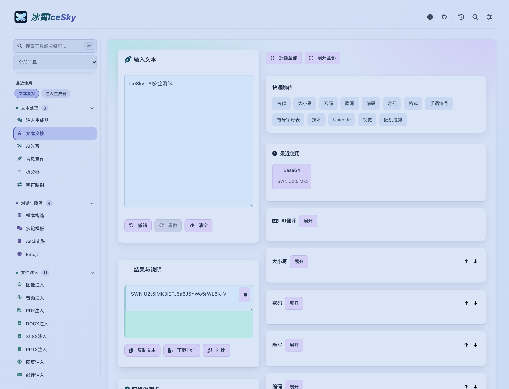

<div align="center">
  
  <h1>冰霄 IceSky</h1>
  <p>面向AI安全测试的多模态提示词注入工具</p>
  <p>
    <a href="README.md">English</a>&nbsp;&nbsp;&nbsp;
    <a href="README.zh-CN.md">简体中文</a>
  </p>
  <p>
    <a href="https://github.com/spindriftpapilio/icesky/wiki"></a>
    <a href="https://github.com/spindriftpapilio/icesky/issues"></a>
    <a href="https://github.com/spindriftpapilio/icesky/stargazers"></a>
  </p>
  <p>
    <a href="#快速开始">快速开始</a>&nbsp;&nbsp;&nbsp;
    <a href="#功能与使用手册">功能与文档</a>&nbsp;&nbsp;&nbsp;
    <a href="#部署">部署</a>&nbsp;&nbsp;&nbsp;
    <a href="#交流群">交流</a>
  </p>
</div>

面向AI安全测试的提示词注入工具。在浏览器中编辑测试载荷，进行文本变换、隐写与多轮对话编排，生成文档、图像、音频、邮件、网页、MCP定义和Agent规则文件等测试样本。

完整操作说明见[Wiki使用手册](https://github.com/spindriftpapilio/icesky/wiki)。使用前请阅读下方的[法律免责声明与使用合规须知](#法律免责声明与使用合规须知)。

## 界面预览

<p align="center">
  <a href="ui.png"></a>
</p>

## 快速开始

本仓库提供可直接部署的静态文件，无需安装Node.js依赖或运行构建命令。

```bash
git clone https://github.com/spindriftpapilio/icesky.git
cd icesky
python3 -m http.server 8080
```

在浏览器中打开<http://localhost:8080>。文本变换、隐写和本地样本生成可直接使用，AI改写、翻译及模型对话测试需先[配置模型接口](https://github.com/spindriftpapilio/icesky/wiki#模型接口ai改写与翻译)。

## 功能与使用手册

### 文本与对话

文本处理支持[编码变换与解码](https://github.com/spindriftpapilio/icesky/wiki#文本变换与解码)、[输入扰动](https://github.com/spindriftpapilio/icesky/wiki#输入扰动与结果比较)、[隐藏文本与字符映射](https://github.com/spindriftpapilio/icesky/wiki#隐藏文本emoji与字符映射)。测试流程可从[提示词生成](https://github.com/spindriftpapilio/icesky/wiki#生成提示词测试样本)开始，配合[多轮对话编排](https://github.com/spindriftpapilio/icesky/wiki#多轮对话编排)、[样本构造与批量导出](https://github.com/spindriftpapilio/icesky/wiki#样本构造与批量导出)，并[保存实验记录](https://github.com/spindriftpapilio/icesky/wiki#保存实验记录)。

### 多模态文件

文件工具涵盖[图像与二维码](https://github.com/spindriftpapilio/icesky/wiki#图像生成与二维码)、[PDF](https://github.com/spindriftpapilio/icesky/wiki#pdf构造与文本对比)、[Office文档](https://github.com/spindriftpapilio/icesky/wiki#word表格与幻灯片)、[音频与字幕](https://github.com/spindriftpapilio/icesky/wiki#音频与字幕)、[网页与邮件](https://github.com/spindriftpapilio/icesky/wiki#网页富文本与邮件)，以及[MCP定义与Agent配置](https://github.com/spindriftpapilio/icesky/wiki#mcp定义与agent配置)。具体写入通道、参数和导出方法见对应章节。

### 工作台与结果

工具搜索、常用工具和快捷键见[工作台操作](https://github.com/spindriftpapilio/icesky/wiki#认识工作台)。分析与参考功能见[Token分析与其他工具](https://github.com/spindriftpapilio/icesky/wiki#token分析与其他工具)，结果更新、模型连接及文件解析问题见[常见问题](https://github.com/spindriftpapilio/icesky/wiki#结果保存与常见问题)。

## 部署

将仓库中的静态文件按原目录结构上传到GitHub Pages、Cloudflare Pages、Netlify、Vercel、S3或其他静态Web服务器即可。保留入口文件及资源目录的相对位置，本地文本处理和样本生成无需配置后端。

## 交流群

<p align="center">
  
</p>

## 法律免责声明与使用合规须知

<details>
<summary>查看完整使用条款</summary>


### 1. 工具定位

冰霄IceSky（以下简称“本工具”）用于AI与网络安全学术研究、获得授权的安全测试、企业内部风险自查和教育演示。提示词注入、隐写、文件载体和Agent规则等功能用于构造测试材料，帮助验证目标系统的输入处理与安全边界。

本工具不授予使用者测试任何第三方系统的权限。生成样本、查阅公开资料或取得API密钥，均不等于获得对目标系统开展安全测试的授权。

### 2. 授权使用原则

对目标系统开展测试前，使用者必须取得系统所有者或有权授权方的合法书面授权，明确测试对象、时间、方法、数据范围、资源消耗上限和停止条件。测试不得超出授权范围，并须遵守适用法律和服务协议。

### 3. 禁止滥用

使用者不得利用本工具：

1. 生成恶意内容进行广泛传播，包括违法信息、诈骗话术、钓鱼链接、恶意代码及用于窃取数据或破坏系统的攻击载荷。
2. 诱导模型或Agent泄露密钥、个人信息和其他未获授权的数据，或执行未获授权的命令、文件操作及外部请求。
3. 将含有恶意载荷的文档、邮件、网页、MCP定义、Skill或Agent规则投放到未经授权的第三方环境。
4. 开展未授权批量测试、网络骚扰、黑灰产活动或以违法方式牟利。
5. 以非法用途规避本工具、目标系统或服务提供方的安全限制和访问控制，或利用高Token用量文本等功能干扰服务、消耗他人资源。
6. 从事危害国家网络安全、扰乱公共秩序或侵犯他人合法权益的活动。

### 4. 风险与责任边界

本工具按现状提供。在适用法律允许的范围内，项目作者、维护者和贡献者不对其准确性、完整性、适用性、持续可用性或测试效果作出保证。

使用者应自行审查输入材料、生成文件、模型接口及目标环境，评估数据泄露、模型调用费用、资源消耗、文件兼容性和服务中断等风险。样本生成成功或本地预览正常，不代表在目标系统中使用是安全、合法或有效的。

使用者应自行承担使用本工具所产生的全部风险及后果。开发者不承担任何责任。因使用、修改、分发本工具或将生成样本用于第三方系统而引起的损失、纠纷及法律责任，均由使用者自行承担，与项目作者、维护者和贡献者无关。

### 5. 合规义务

使用者应了解并遵守所在地、目标系统所在地及测试活动适用的法律法规。

使用者须妥善保管授权证明和必要的测试记录，按约定处理、保存和删除测试数据。向外部模型接口发送材料前，应确认具备相应的数据处理权限，不得擅自上传个人信息、商业秘密或其他受保护数据。

### 6. 违规处置

对于已知或有合理依据怀疑涉及违法滥用的请求，项目维护者可拒绝提供技术答疑、指导或协助，并可在法律及适用许可允许的范围内调整项目分发、维护安排和安全限制。

对通过问题反馈、公开渠道或其他合法途径获知的滥用线索，维护者可依法保留必要证据并向有关平台或主管机关报告。本条不表示本工具具备远程监控、追踪使用者或撤回已下载副本的能力。

### 7. 最终声明

请在使用前阅读上述条款，并自行确认测试活动已获授权且符合法律要求。如无法确认授权或合规性，请勿对目标系统开展测试。

本工具严禁非法滥用。任何违法使用行为所产生的法律责任均由行为人自行承担，与项目开发、维护和贡献团队无关。

</details>

## Star趋势

[](https://star-history.com/#spindriftpapilio/icesky&Date)
